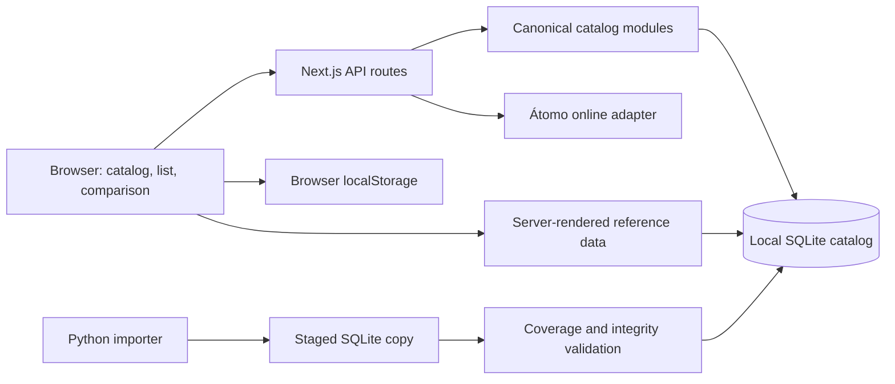

# Architecture

## Runtime

The active UI is `app/page.tsx` and `app/referencias/page.tsx`. Shared list
state lives in `lib/cart-context.tsx`, mounted by `app/layout.tsx`.
`components/Cart/` handles the list and comparison. `lib/net-savings.ts`
is a pure calculation over canonical offers returned by the server.

## Main contracts

| Concern | Entry point | Responsibility |
| --- | --- | --- |
| Search and filters | `app/api/products/route.ts` | Validate parameters, combine source results, filter before grouping/pagination |
| Local catalog | `lib/catalog.ts` | Resolve canonical products, branch metadata and exact equivalents |
| Regional vocabulary | `lib/search-vocabulary.ts` | Query expansion with context and exclusions, not identity replacement |
| Basket offers | `app/api/products/optimize/route.ts` | Validate list and retrieve canonical equivalent offers |
| Net savings | `lib/net-savings.ts` | Evaluate complete assignments, costs and visit constraints |
| Cart recovery | `app/api/products/refresh/route.ts`, `lib/cart-products.ts` | Refresh SEPA details while preserving quantities and online lines |
| References | `lib/reference-catalog-server.ts`, `lib/market-references.ts` | Keep catalog observations separate from official regional figures |
| Import | `data-pipeline/update_prices.py` | Stage, validate, back up and publish an official snapshot |
| Fresh schema | `data-pipeline/init_db.py`, `schema.sql` | Create an empty database without overwriting an existing file |

A product's display name is not its identity. Valid global codes may match across
retailers; internal/restricted codes are scoped. Quantities and package content
are different dimensions. Missing offers are not zero-priced offers.

Online items preserve their channel and saved price. No inferred Átomo-to-SEPA
identity is used when applying a basket recommendation.

## Data boundaries

Browser input, localStorage and provider responses need runtime validation;
TypeScript alone cannot validate them. The database is local and operationally
separate from the code. The source date is shown independently of the time a
request is made. Reference calculations open the catalog read-only.

The current server is intended for local use. A public deployment needs an
explicit security/operations design, measured concurrency and persistent storage.

## Earlier implementation

`components/ShoppingList.tsx`, `ProductInput.tsx`, `ProductSelector.tsx` and
`StoreRecommendation.tsx` belong to an earlier UI and are not mounted by the
active page. The search/batch/location compatibility API routes remain in the
application. Historical Vea/Carrefour adapters and diagnostic scripts are not
evidence that all those stores are active online sources.

`data-pipeline/load-db.ts` and `sepa-ingestor.ts` are historical importers.
Use the Python updater for the current catalog; their old input files are not
distributed. Retiring this code is a documented follow-up, not silently hidden
from lint or type checks.
